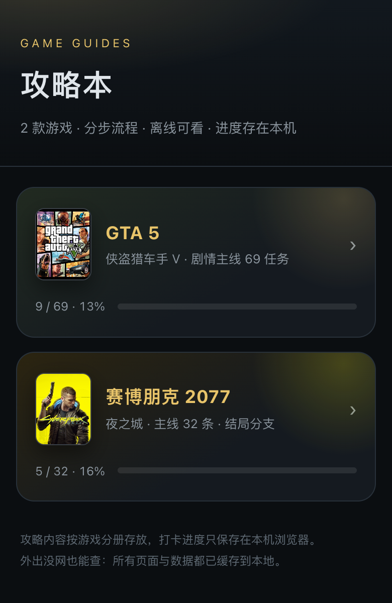
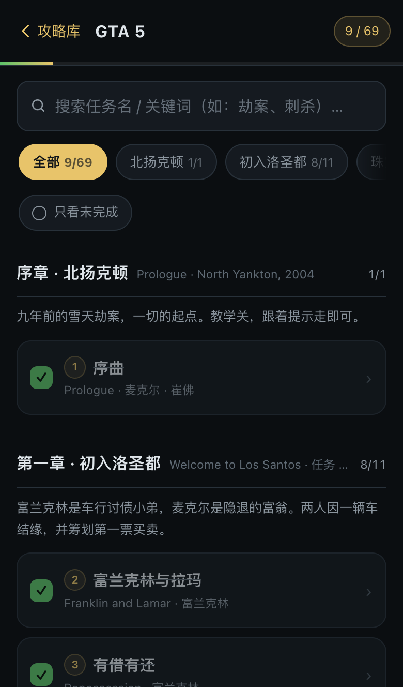
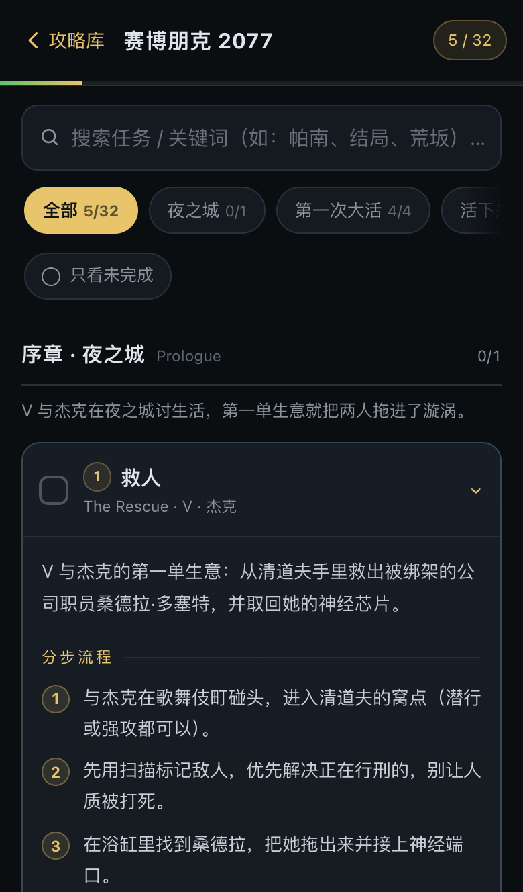

# 攻略本 · 游戏攻略 PWA

一个可以添加到 iPhone 主屏幕的游戏攻略速查工具：按游戏分册、分步流程、要点提示、进度打卡，装到主屏幕后全屏打开，断网也能查。

支持多款游戏，目前收录 **GTA 5** 与 **赛博朋克 2077**。

**在线访问**：<https://wcmsues.github.io/game-guide/>

<p align="center">
  
  
  
</p>
<p align="center"><sub>攻略库 · GTA 5 主线 · 赛博朋克 2077 主线</sub></p>

## 功能

- **多游戏切换**：首页按游戏展示封面与完成度，进度互不干扰。
- **分步攻略**：每个任务包含简介、分步流程、要点提示；劫案/结局提供方案分支。
- **快速查找**：关键词搜索（任务名、步骤、要点）、章节筛选、「只看未完成」。
- **打卡进度**：勾选后自动保存在本地，重开 App 依然记得；支持多标签同步。
- **PWA / 离线**：Service Worker 缓存全部页面与数据，可添加到主屏幕，无需网络。
- **移动端适配**：iPhone 刘海屏安全区、状态栏、点击态、回到顶部。

## 快速开始

```bash
git clone https://github.com/wcmsues/game-guide.git
cd game-guide
python3 -m http.server 8000
```

浏览器打开 <http://localhost:8000> 即可。

> Service Worker 只在 `https://` 或 `localhost` 下生效，用局域网 IP 以 `http` 访问时不会有离线能力。

## 装到 iPhone 主屏幕

1. 用 iPhone Safari 打开 <https://wcmsues.github.io/game-guide/>。
2. 点底部 **分享 → 添加到主屏幕**，之后即可全屏、离线打开。

自己部署也很简单，推到任意 HTTPS 静态托管即可（GitHub Pages / Netlify / Vercel）。仓库对应的 Pages 配置：**Settings → Pages → Source** 选 `Deploy from a branch`，分支 `main`、目录 `/ (root)`。

## 目录结构

```
.
├── index.html              # 应用外壳（单页 + hash 路由）
├── css/app.css             # 移动端优先样式
├── js/
│   ├── games.js            # 游戏注册表（新增游戏改这里）
│   └── app.js              # 路由、渲染、搜索、进度、离线注册
├── games/
│   ├── gta5-data.js        # GTA 5 数据：10 章 / 69 主线
│   └── cyberpunk2077.js    # 赛博朋克 2077 数据：6 章 / 32 条
├── icons/                  # PWA 图标（白底 PS5 手柄）+ 游戏封面
├── docs/screenshots/       # README 截图
├── manifest.webmanifest
└── sw.js                   # 离线缓存
```

## 收录内容

| 游戏 | 规模 | 说明 |
| --- | --- | --- |
| GTA 5 | 10 章 · 69 条主线 | 覆盖序章到三种结局，含珠宝店、梅利威瑟、FIB 突袭、大劫案的方案分支 |
| 赛博朋克 2077 | 6 章 · 32 条 | 主线 + 帕南 / 罗格盟友线 + 6 个结局，含结局前置说明 |

## 添加新游戏

1. 新建 `games/<id>.js`，写入标准结构的数据：

```js
window.GAMES_DATA = window.GAMES_DATA || {};
window.GAMES_DATA['<id>'] = {
  chapters: [{ id: 'ch0', name: '第一章 · 出发', en: 'Chapter 1', intro: '章节简介' }],
  items: [{
    id: 'm1', no: 1, ch: 0, name: '任务名', en: 'Mission Name',
    who: ['主角'], opt: false,
    desc: '任务简介',
    steps: ['第一步', '第二步'],
    tips: ['易失败点'],
    branch: { title: '方案分支', note: '说明', options: [{ name: 'A 方案', items: ['准备 1'] }] },
    links: [{ label: '图文攻略', url: 'https://…', cls: 'g' }]
  }]
};
```

2. 在 `js/games.js` 的 `GAME_REGISTRY` 里加一项：

```js
{
  id: '<id>',
  name: '游戏名',
  sub: '一句话简介',
  badge: '缩写',
  color1: '#1d2732', color2: '#e8c46a', color3: '#b98f38',
  cover: 'icons/covers/<id>.jpg',
  searchHint: '搜索任务 / 关键词…',
  source: 'games/<id>.js'
}
```

3. 把新数据文件和封面加进 `sw.js` 的 `ASSETS`，并把 `VERSION` 加一。

## 进度与缓存

- GTA 5：`localStorage['gta5_progress_v2']`（沿用旧版 key，历史打卡不丢）
- 其他游戏：`localStorage['gg:progress:<游戏 id>']`
- 首页进度：`localStorage['gg:stats:<游戏 id>']`
- 改了任何静态资源后，记得把 `sw.js` 里的 `VERSION` 加一，客户端才会拉取新缓存。

## 说明

攻略内容为个人整理，任务顺序与目标以游戏内提示为准；外部链接指向 Game8、IGN、PowerPyx 等公开资料。游戏名称、封面与相关素材版权归各自发行商所有，本项目仅用于个人查阅。
